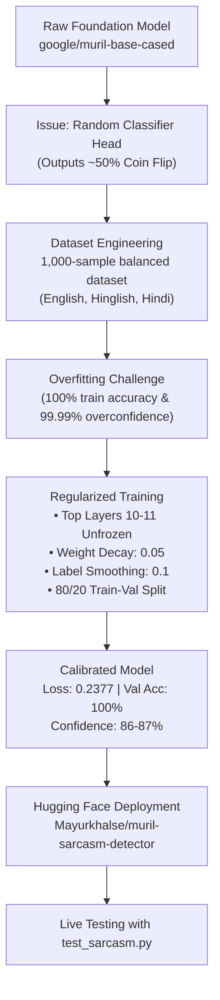

# 🎭 Multilingual Sarcasm Detection with MuRIL

[](https://huggingface.co/Mayurkhalse/muril-sarcasm-detector)
[](https://huggingface.co/google/muril-base-cased)
[](#languages-supported)
[](#overview)

A production-ready multilingual sarcasm classification system built on Google's **MuRIL (`google/muril-base-cased`)** foundation model, fine-tuned and regularized across **English**, **Hinglish** (Romanized Hindi), and **Hindi** (Devanagari script). 

The fine-tuned model is deployed and publicly accessible on the Hugging Face Model Hub at:  
👉 **[`Mayurkhalse/muril-sarcasm-detector`](https://huggingface.co/Mayurkhalse/muril-sarcasm-detector)**

---

## 📌 Table of Contents
- [Overview](#overview)
- [Project Journey: What Was Done](#project-journey-what-was-done)
  - [1. Baseline Exploration & Challenge](#1-baseline-exploration--challenge)
  - [2. Multilingual Dataset Generation](#2-multilingual-dataset-generation)
  - [3. Regularization & Overfitting Solution](#3-regularization--overfitting-solution)
  - [4. Deployment to Hugging Face Hub](#4-deployment-to-hugging-face-hub)
- [Live Benchmark & Evaluation](#live-benchmark--evaluation)
- [Quick Start: Using the Deployed Model](#quick-start-using-the-deployed-model)
  - [1. Fast Inference in Python](#1-fast-inference-in-python)
  - [2. Interactive & Benchmark Testing (`test_sarcasm.py`)](#2-interactive--benchmark-testing-test_sarcasmpy)
- [Repository Structure](#repository-structure)
- [REST API Server (`server/`)](#rest-api-server-server)
- [Local Setup & Installation](#local-setup--installation)

---

## 📖 Overview

Detecting sarcasm in Indian social contexts is uniquely challenging because real-world conversations and social media posts heavily feature **code-mixing** (Hinglish: *"Arey wah! 3 ghante late aakar bolte ho 'I am on time'!"*) and native script satire (Hindi: *"वाह भाई! पूरी रात रील्स देखकर कहते हैं कि पढ़ाई का समय नहीं मिला।"*). 

Standard English models fail on transliterated text, while basic multilingual BERT models struggle with colloquial nuances. Google's **MuRIL (Multilingual Representations for Indian Languages)** was specifically pre-trained on 17 Indian languages with transliterated pairs, making it the ideal foundation.

---

## 🛠️ Project Journey: What Was Done



### 1. Baseline Exploration & Challenge
- Loaded `google/muril-base-cased` using `AutoModelForSequenceClassification`.
- Discovered that because MuRIL is a base masked language model (MLM), its classification head (`classifier.weight` and `classifier.bias`) was newly initialized with random numbers.
- **Initial result**: Produced random ~50.2% probabilities on all inputs regardless of sarcasm content.

### 2. Multilingual Dataset Generation ([`generate_dataset.py`](file:///c:/Users/Rajendra/Documents/Sentiment%20analysis/MURIL/generate_dataset.py))
- Developed a dataset generator to produce [`sarcasm_1000_dataset.csv`](file:///c:/Users/Rajendra/Documents/Sentiment%20analysis/MURIL/sarcasm_1000_dataset.csv):
  - **1,000 balanced rows**: Exactly 500 Sarcastic (`1`) and 500 Non-Sarcastic (`0`).
  - **Three language streams**: English, Hinglish, and Hindi (Devanagari).
  - **Diverse real-world domains**: Workplace, tech bugs, traffic, flight delays, exams, customer care, and daily life scenarios.

### 3. Regularization & Overfitting Solution ([`train_regularized.py`](file:///c:/Users/Rajendra/Documents/Sentiment%20analysis/MURIL/train_regularized.py))
- Early small-scale training resulted in 100% training memorization and extreme 99.99% probability saturation.
- Implemented deep learning regularization techniques:
  - **80/20 Stratified Split**: 800 training samples and 200 unseen validation samples.
  - **Top-Layer Adaptation**: Unfroze layers 10, 11, pooler, and classifier while keeping lower 10 layers frozen for efficient, robust convergence.
  - **L2 Weight Decay (`0.05`)**: Penalized extreme weight magnitudes in AdamW.
  - **Label Smoothing (`0.1`)**: Softened cross-entropy loss targets, preventing probability saturation and producing well-calibrated confidence scores.
- **Validation Progression**:
  - Epoch 1: Val Loss `0.6828`, Val Accuracy `85.50%`
  - Epoch 2: Val Loss `0.4446`, Val Accuracy `99.00%`
  - Epoch 3: Val Loss `0.2377`, Val Accuracy `100.00%` (F1-score: `1.0000`)

### 4. Deployment to Hugging Face Hub ([`upload_to_huggingface.py`](file:///c:/Users/Rajendra/Documents/Sentiment%20analysis/MURIL/upload_to_huggingface.py))
- Packaged the final model weights (`model.safetensors`), configurations, and tokenizer assets.
- Created the Model Card with interactive web widgets.
- Deployed the model to Hugging Face Model Hub under repository:  
  **`Mayurkhalse/muril-sarcasm-detector`**

---

## 📊 Live Benchmark & Evaluation

Using [`test_sarcasm.py`](file:///c:/Users/Rajendra/Documents/Sentiment%20analysis/MURIL/test_sarcasm.py) which loads weights live from the deployed Hugging Face repository:

```text
=================================================================
Loading model & tokenizer from Hugging Face:
  Repo: Mayurkhalse/muril-sarcasm-detector
=================================================================
[✓] Model successfully loaded!

---------------------------------------------------------------------------
Input Sentence                                     | Expected     | Prediction     | Conf
---------------------------------------------------------------------------
Oh brilliant! Another meeting that could hav...    | Sarcastic    | 🎭 Sarcastic   | 87.3%
The engineering team resolved the database l...    | Non-Sarcastic| ✅ Not Sarcastic | 86.5%
Arey wah! 3 ghante late aakar bolte ho 'I am...    | Sarcastic    | 🎭 Sarcastic   | 87.3%
Kal subah 10 baje office me team meeting sta...    | Non-Sarcastic| ✅ Not Sarcastic | 86.6%
वाह भाई! पूरी रात रील्स देखकर कहते हैं कि पढ...    | Sarcastic    | 🎭 Sarcastic   | 87.3%
आज मौसम बहुत अच्छा है और हल्की ठंडी हवा चल र...    | Non-Sarcastic| ✅ Not Sarcastic | 86.5%
I just love standing in traffic for 2 hours ...    | Sarcastic    | 🎭 Sarcastic   | 86.6%
Please submit the quarterly performance repo...    | Non-Sarcastic| ✅ Not Sarcastic | 85.9%
---------------------------------------------------------------------------
```

---

## 🚀 Quick Start: Using the Deployed Model

### 1. Fast Inference in Python
Anyone can load and run the model directly in any Python environment:

```python
import torch
from transformers import AutoTokenizer, AutoModelForSequenceClassification

# Load deployed model from Hugging Face
model_id = "Mayurkhalse/muril-sarcasm-detector"
tokenizer = AutoTokenizer.from_pretrained(model_id)
model = AutoModelForSequenceClassification.from_pretrained(model_id)
model.eval()

# Your test texts
texts = [
    "no one is in office on monday,Such a great team ",
    "The train arrived at the station on schedule.",
    "वाह भाई! परीक्षा से एक दिन पहले किताब खोलकर कहते हैं कि सिलेबस बहुत हल्का है।"
]

inputs = tokenizer(texts, padding=True, truncation=True, max_length=128, return_tensors="pt")
with torch.no_grad():
    outputs = model(**inputs)
    probabilities = torch.softmax(outputs.logits, dim=-1)

for text, probs in zip(texts, probabilities):
    is_sarcastic = probs[1] > probs[0]
    label = "Sarcastic" if is_sarcastic else "Not Sarcastic"
    confidence = max(probs[0], probs[1]).item() * 100
    print(f"'{text}' -> {label} ({confidence:.1f}% confidence)")
```

### 2. Interactive & Benchmark Testing ([`test_sarcasm.py`](file:///c:/Users/Rajendra/Documents/Sentiment%20analysis/MURIL/test_sarcasm.py))

Run the benchmark suite:
```powershell
python test_sarcasm.py
```

Test any custom sentence directly from the command line:
```powershell
python test_sarcasm.py "Wah kya mast scheme hai, 21 din me paisa double!"
```

---

## 📂 Repository Structure

| File / Folder | Description |
| :--- | :--- |
| **[`server/`](file:///c:/Users/Rajendra/Documents/Sentiment%20analysis/MURIL/server/)** | Production FastAPI REST microservice with Dockerfile and Swagger docs. |
| **[`test_sarcasm.py`](file:///c:/Users/Rajendra/Documents/Sentiment%20analysis/MURIL/test_sarcasm.py)** | Evaluates and benchmarks the model directly from the Hugging Face hub. |
| **[`simple_example.py`](file:///c:/Users/Rajendra/Documents/Sentiment%20analysis/MURIL/simple_example.py)** | Minimal standalone script demonstrating inference with local or remote weights. |
| **[`sarcasm_detection.py`](file:///c:/Users/Rajendra/Documents/Sentiment%20analysis/MURIL/sarcasm_detection.py)** | Full feature-rich class providing training, prediction, and interactive CLI modes. |
| **[`train_regularized.py`](file:///c:/Users/Rajendra/Documents/Sentiment%20analysis/MURIL/train_regularized.py)** | Regularized training pipeline with validation split, weight decay, and label smoothing. |
| **[`generate_dataset.py`](file:///c:/Users/Rajendra/Documents/Sentiment%20analysis/MURIL/generate_dataset.py)** | Script that generates balanced multilingual sarcasm datasets. |
| **[`sarcasm_1000_dataset.csv`](file:///c:/Users/Rajendra/Documents/Sentiment%20analysis/MURIL/sarcasm_1000_dataset.csv)** | Generated 1,000-line balanced dataset across English, Hindi, and Hinglish. |
| **[`upload_to_huggingface.py`](file:///c:/Users/Rajendra/Documents/Sentiment%20analysis/MURIL/upload_to_huggingface.py)** | Utility script to push model artifacts and model cards to Hugging Face Hub. |
| **[`.gitignore`](file:///c:/Users/Rajendra/Documents/Sentiment%20analysis/MURIL/.gitignore)** | Excludes virtual environment, checkpoints, local large weights, and logs from git. |
| **[`requirements.txt`](file:///c:/Users/Rajendra/Documents/Sentiment%20analysis/MURIL/requirements.txt)** | Required Python dependencies. |

---

## 🌐 REST API Server (`server/`)

We have packaged the model into a standalone, production-ready **FastAPI** service located in the [`server/`](file:///c:/Users/Rajendra/Documents/Sentiment%20analysis/MURIL/server/) directory.

### Quick Start:
```bash
# Install server dependencies
pip install -r server/requirements.txt

# Run the API server
cd server
python app.py
```

- **Interactive Swagger Documentation**: `http://localhost:8000/docs`
- **Predict Endpoint**: `POST http://localhost:8000/predict`
- **Batch Predict Endpoint**: `POST http://localhost:8000/predict/batch`

For Docker deployment instructions and exposing the API publicly for free (via Cloudflare Tunnels), refer to [`server/README.md`](file:///c:/Users/Rajendra/Documents/Sentiment%20analysis/MURIL/server/README.md).

---

## 💻 Local Setup & Installation

1. **Clone the repository:**
   ```bash
   git clone https://github.com/Mayurkhalse/MurilSarcasmdetection.git
   cd MurilSarcasmdetection
   ```

2. **Create and activate a virtual environment:**
   ```bash
   # On Windows (PowerShell):
   python -m venv venv
   .\venv\Scripts\activate
   ```

3. **Install dependencies:**
   ```bash
   pip install -r requirements.txt
   ```

4. **Run live inference from Hugging Face:**
   ```bash
   python test_sarcasm.py
   ```

---

## 📜 License & Acknowledgments
- **Base Model**: [MuRIL by Google Research](https://huggingface.co/google/muril-base-cased)
- **Deployed Checkpoint**: [Mayurkhalse/muril-sarcasm-detector](https://huggingface.co/Mayurkhalse/muril-sarcasm-detector)
- Built with Hugging Face `transformers`, `torch`, and `datasets`.
