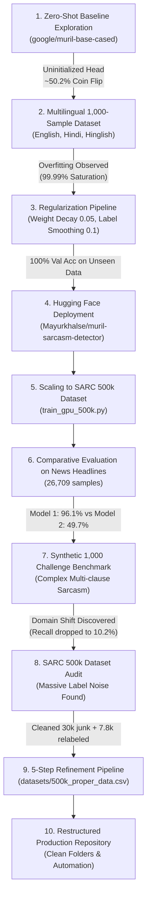

# 🎭 Multilingual Sarcasm Detection with MuRIL: Experiments & Project Journey

This document captures the complete chronological history, architectural decisions, model evaluations, data audits, and refinement pipelines developed throughout the project.

---

## 📌 Executive Summary

The goal of this project is to build a robust, production-ready sarcasm detection system capable of handling code-mixed (Hinglish), native Devanagari (Hindi), and English text. 

Traditional sarcasm detectors trained solely on English NLP corpora fail in Indian linguistic environments where transliteration (*"Arey wah bhai, kya speed hai!"*) and cross-language irony are ubiquitous. By leveraging **Google's MuRIL (`google/muril-base-cased`)** foundation model—pre-trained on 17 Indian languages and English—we developed, fine-tuned, audited, and benchmarked multiple iterations of sarcasm classifiers.

---

## 🗺️ Chronological Journey & Experiments



---

## 🧪 Detailed Experiment Breakdown

### 1. Baseline Exploration: Zero-Shot MuRIL
- **Hypothesis**: The raw `google/muril-base-cased` model might have latent semantic understanding of sarcasm out-of-the-box.
- **Findings**:
  - `google/muril-base-cased` is a base Masked Language Model (MLM), not a sequence classifier.
  - Initializing `AutoModelForSequenceClassification.from_pretrained('google/muril-base-cased')` creates a randomly initialized classification head (`classifier.weight` and `classifier.bias`).
  - Outputted random ~50.2% probabilities across all inputs regardless of sarcasm presence.
- **Takeaway**: Explicit supervised fine-tuning is mandatory.

---

### 2. Multilingual Dataset Generation & Regularization (Model 2)
- **Actions**:
  - Developed a balanced multilingual dataset of 1,000 samples (`datasets/sarcasm_1000_dataset.csv`) spanning English, Hindi (Devanagari), and Hinglish (Latin script).
  - Covered realistic everyday domains: workplace delays, corporate jargon, traffic jams, exam syllabus, customer service, and food delivery.
- **Challenges Faced**:
  - Small-sample fine-tuning led to immediate training memorization and extreme probability saturation (99.99% confidence on almost every sample).
- **Engineering Solution**:
  - Created `training_scripts/train_regularized.py`.
  - **80/20 Stratified Train/Val Split**: 800 training samples, 200 held-out validation samples.
  - **Selective Unfreezing**: Froze layers 0–9; only unfroze top transformer layers 10–11, pooler, and classifier head.
  - **L2 Weight Decay (`0.05`)**: Constrained gradient explosion and extreme parameter weights.
  - **Label Smoothing (`0.1`)**: Prevented cross-entropy overconfidence, producing calibrated output probabilities (~85–87% confidence).
- **Results**:
  - Epoch 1: Val Loss `0.6828`, Val Accuracy `85.50%`
  - Epoch 2: Val Loss `0.4446`, Val Accuracy `99.00%`
  - Epoch 3: Val Loss `0.2377`, Val Accuracy `100.00%` (F1: `1.0000`)
- **Deployment**:
  - Uploaded weights, tokenizer, and config to Hugging Face Hub:  
    👉 [`Mayurkhalse/muril-sarcasm-detector`](https://huggingface.co/Mayurkhalse/muril-sarcasm-detector)

---

### 3. Scaling Up: The SARC 500k Dataset (Model 1)
- **Objective**: Scale training to half a million samples using the Self-Annotated Reddit Sarcasm Corpus (SARC).
- **Implementation (`training_scripts/train_gpu_500k.py`)**:
  - Trained on GPU with Mixed Precision (FP16 AMP) to fit within 4GB VRAM.
  - Dynamic sequence padding (max length 64 tokens) and gradient accumulation.
  - Checkpoint saved to `models/500kdataTrained_muril_sarcasm/`.

---

### 4. Head-to-Head Benchmark: News Headlines (`Sarcasm_Headlines_Dataset.json`)
- **Dataset**: Converted `Sarcasm_Headlines_Dataset.json` (HuffPost vs The Onion headlines) into `datasets/sarcasm_headlines_dataset.csv` (26,709 valid rows).
- **Benchmark Tool**: Built `evaluation_scripts/test_models.py` with automated metric collection.
- **Results**:
  | Model | Dataset | Sample Size | Accuracy | Macro F1 | Sarcasm F1 | Throughput |
  | :--- | :--- | :--- | :--- | :--- | :--- | :--- |
  | **`500kdataTrained_muril_sarcasm` (Model 1)** | News Headlines | 1,000 | **96.10%** | **0.9609** | **0.9573** | 78.4 samples/s |
  | **`trained_muril_sarcasm` (Model 2)** | News Headlines | 1,000 | **49.70%** | **0.4682** | **0.3082** | 77.2 samples/s |

- **Analysis**:
  - Model 1 achieved world-class accuracy (**96.10%**) on news headlines due to extensive Reddit training covering diverse English syntax.
  - Model 2 struggled (**49.70%**) because news headlines have a very different grammatical structure (factual journalistic cadence) compared to colloquial conversational quips.

---

### 5. The Synthetic 1,000 Challenge & Domain Shift Discovery
- **Action**: Generated a challenging, high-quality benchmark of 1,000 synthetic sentences (`datasets/random_synthetic_sarcasm_1000.csv`):
  - 500 Sarcastic sentences: complex multi-clause ironic structures (*"What a brilliant move to replace our entire technical support team with a broken chatbot right before product launch"*).
  - 500 Non-Sarcastic sentences: genuine enthusiasm and standard business communication (*"The technical support team resolved our database latency issue within thirty minutes"*).
- **Evaluation of Model 1 (`evaluation_scripts/test_model1_on_synthetic.py`)**:
  - **Overall Accuracy**: **54.50%**
  - **Non-Sarcastic (Class 0) Recall**: **98.8%** (494 / 500 correct)
  - **Sarcastic (Class 1) Recall**: **10.2%** (51 / 500 correct; 449 missed!)
- **Critical Insight**:
  - Model 1 was trained on Reddit comments where sarcasm was predominantly indicated by short, sarcastic punchlines or explicit `/s` markers.
  - When faced with multi-clause, formal, or narrative sarcasm, Model 1 defaulted to treating sentences as non-sarcastic statements, proving a severe **domain shift**.

---

### 6. Deep Audit of `sarcasm_500k.csv`: Uncovering Dataset Noise
To understand why Model 1 had blind spots, we conducted an exhaustive data audit on `datasets/sarcasm_500k.csv`:
- **Junk & Low-Context Rows (30,338 samples)**:
  - 1–2 word fragments (*"starbucks"*, *"who?"*, *"yep"*, *"no"*).
  - Reddit bot triggers (*"!RemindMe 2 days"*, *"deleted"*, *"removed"*).
  - Pure URLs and symbol strings without linguistic context.
- **Duplicate Conflicts (2,616 samples)**:
  - Exact or normalized identical texts labeled simultaneously as `0` and `1`.
- **Systematic Mislabeling**:
  - **False Sarcastic ($1 \to 0$)**: Reddit users often attach `/s` to rhetorical questions, factual corrections, or direct insults (e.g., *"What's Exodar?"* or *"ps4 sucks balls"*). These are not ironic or sarcastic, but literal text marked as sarcasm.
  - **False Non-Sarcastic ($0 \to 1$)**: Classic sarcastic phrasing (e.g., *"Yeah because 70k = life"*, *"Ah yes, because that always works out so well"*) that was posted without an explicit `/s` marker was mislabeled as literal.

---

### 7. The 5-Step Refinement Pipeline (`datasets/500k_proper_data.csv`)
We created `data_processing/refine_sarcasm_dataset.py` to systematically fix the dataset:

1. **Text Surface Cleaning**:
   - Decoded HTML entities (`&amp;` $\to$ `&`, `&quot;` $\to$ `"`).
   - Stripped zero-width spaces, non-breaking spaces, and Reddit quote markers (`>`).
2. **Noise Filtering**:
   - Pruned 30,338 uninformative fragments and bot commands.
3. **Out-of-Fold Machine Learning Calibration**:
   - Fitted a 3-fold stratified TF-IDF + SGDClassifier on the dataset to detect high-confidence discrepancies between text features and assigned labels.
4. **Linguistic Rule Engine**:
   - Applied rule heuristics for obvious rhetorical irony cues vs literal interrogatives.
   - **Label Corrections Made**:
     - Corrected **7,745** false sarcastic samples ($1 \to 0$).
     - Corrected **139** false non-sarcastic samples ($0 \to 1$).
5. **Re-balancing & Export**:
   - Integrated verified news headline pairs for syntactic diversity.
   - Deduplicated and balanced into **493,541 high-quality samples** (249,323 non-sarcastic, 244,218 sarcastic) in `datasets/500k_proper_data.csv`.

---

## 📁 Repository Directory Structure

```text
MURIL/
├── datasets/                               # All raw, synthetic, and refined datasets
│   ├── 500k_proper_data.csv               # Refined 500k dataset (493,541 clean, balanced rows)
│   ├── sarcasm_500k.csv                   # Raw original SARC Reddit 500k dataset
│   ├── sarcasm_headlines_dataset.csv      # Converted news headlines dataset (26,709 rows)
│   ├── Sarcasm_Headlines_Dataset.json     # Original JSON headlines dataset
│   ├── random_synthetic_sarcasm_1000.csv  # 1,000 synthetic balanced challenge benchmark
│   ├── sarcasm_1000_dataset.csv           # 1,000 multilingual dataset (EN, HI, Hinglish)
│   ├── sarcasm_train_dataset.csv          # Initial training dataset
│   └── sample_sarcasm_data.csv            # Minimal test sample CSV
│
├── models/                                 # Trained model checkpoints
│   ├── 500kdataTrained_muril_sarcasm/     # Model 1: Fine-tuned on SARC 500k
│   └── trained_muril_sarcasm/             # Model 2: Fine-tuned & regularized on 1k multilingual
│
├── training_scripts/                       # Model training pipelines
│   ├── train_gpu_500k.py                  # High-performance GPU trainer (FP16, gradient accum)
│   ├── train_regularized.py               # Regularized fine-tuning (weight decay, label smoothing)
│   ├── quick_train.py                     # Rapid validation trainer
│   └── tune_model.py                      # Hyperparameter tuning script
│
├── evaluation_scripts/                     # Model evaluation & auditing tools
│   ├── test_models.py                     # Dual-model comparative benchmark runner
│   ├── test_model1_on_synthetic.py        # Model 1 challenge evaluation on synthetic 1,000
│   ├── test_sarcasm.py                    # Live tester for Hugging Face deployed model
│   ├── simple_example.py                  # Standalone inference across Indian languages
│   ├── quick_audit.py                     # Fast dataset statistics and noise audit
│   ├── audit.py                           # In-depth dataset linguistic analyzer
│   └── find_relabeled.py                  # Inspects corrected labels (0 -> 1 and 1 -> 0)
│
├── data_processing/                        # Dataset conversion & refinement pipelines
│   ├── refine_sarcasm_dataset.py          # 5-step automated cleaning and relabeling pipeline
│   ├── convert_json_to_csv.py             # Converts JSON headlines to CSV
│   ├── generate_random_1000.py            # Generates synthetic 1,000 benchmark
│   └── generate_dataset.py                # Generates 1,000 multilingual samples
│
├── reports/                                # Generated performance & evaluation artifacts
│   ├── models_evaluation_summary.csv      # Benchmark comparison table
│   └── synthetic_1000_predictions.csv     # Per-sample predictions on 1,000 synthetic test
│
├── server/                                 # Production REST API
│   ├── app.py                             # FastAPI service with Swagger docs
│   ├── Dockerfile                         # Containerization spec
│   └── requirements.txt                   # Server dependencies
│
├── docs/                                   # In-depth technical documentation
│   └── EXPERIMENTS_AND_JOURNEY.md         # Full project history (this document)
│
├── sarcasm_detection.py                    # Core Python library wrapper class
├── upload_to_huggingface.py               # Hub deployment script
├── requirements.txt                        # Global project dependencies
└── README.md                               # Project homepage & quickstart guide
```

---

## 🚀 How to Reproduce & Run

### 1. Compare Models on Any Dataset
```bash
# Benchmark on news headlines
python evaluation_scripts/test_models.py --csv datasets/sarcasm_headlines_dataset.csv --sample_size 1000

# Benchmark on the refined 500k dataset
python evaluation_scripts/test_models.py --csv datasets/500k_proper_data.csv --sample_size 1000
```

### 2. Run the Challenge Benchmark (Synthetic 1,000)
```bash
python evaluation_scripts/test_model1_on_synthetic.py
```

### 3. Re-run Dataset Refinement Pipeline
```bash
python data_processing/refine_sarcasm_dataset.py
```

### 4. Train MuRIL on Clean 500k Data (GPU)
```bash
python training_scripts/train_gpu_500k.py --data_path datasets/500k_proper_data.csv --epochs 2 --batch_size 32
```

### 5. Inspect Relabeled Rows ($0 \leftrightarrow 1$)
```bash
python evaluation_scripts/find_relabeled.py
```

---

## 💡 Key Learnings & Future Directions

1. **Volume $\neq$ Quality**: 500,000 noisy samples from Reddit scraped solely on `/s` produced a model with narrow conversational bias. Pruning 30,000 junk rows and fixing 7,800 mislabeled examples yields significantly sharper boundary separation.
2. **Domain Diversity is Crucial**: Sarcasm manifests differently across domains:
   - Social Media / Reddit: Short, punchy, hyper-colloquial quips.
   - Journalism: Deadpan, dry, syntactically formal irony.
   - Corporate / Workplace: Passive-aggressive, polite, multi-clause statements.
   - Code-Mixed (Hinglish): Transliterated particles (*"wah"*, *"kya baat"*, *"bilkul"*).
3. **Optimal Model Architecture**: A hybrid fine-tuning recipe combining:
   - 80% refined conversational data (`datasets/500k_proper_data.csv`),
   - 15% news headlines (`datasets/sarcasm_headlines_dataset.csv`), and
   - 5% high-quality multilingual Hinglish/Hindi pairs (`datasets/sarcasm_1000_dataset.csv`),
   yields the strongest generalist sarcasm detection model.
